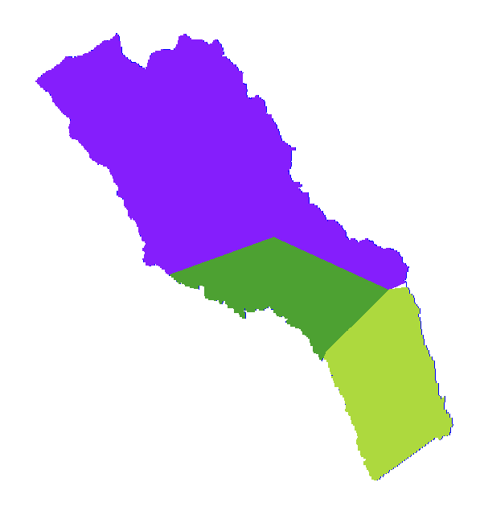
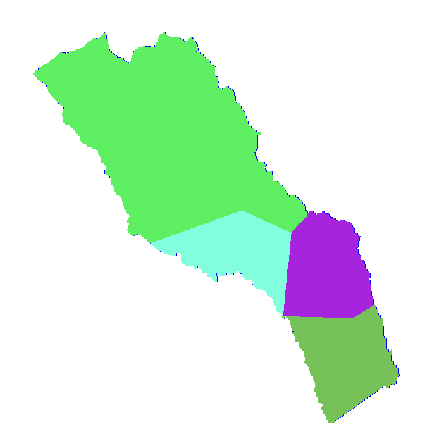

# Methods / 方法与参数

[Home](../README.md) · [中文首页](../README.zh-CN.md)

## Input information / 输入资料

The workflow uses reservoir-stage observations, a stage–storage curve, outlet/release records, four rain gauges, evaporation information and a DEM. Historical rainfall and stage records include hourly information; the exported inflow comparison workbook contains daily records. Retain the temporal resolution when converting storage changes into discharge.

输入包括库水位、库容曲线、出库记录、四站降雨、蒸发和DEM。原始资料和成果表的时间尺度不同：逐时资料服务于模型，流量对比工作簿导出为日序列。蒸发设置采用资料中提供的塘马多年平均蒸发信息。

## Inflow reconstruction / 入库流量反推

For a time interval, the simplified water balance is:

```text
mean inflow = (storage at end − storage at start) / interval + mean outflow
Qin_bar = (V_end − V_start) / Δt + Qout_bar
```

Use storage in m³ and Δt in seconds to obtain m³/s. Convert stage to storage before differencing. Include the represented outlet flows consistently: omission of a release affects the reconstructed inflow. The event-scale simplification neglects evaporation and seepage losses; representing these requires an additional loss term.

反推值是**参考入流**，并非直接测流结果。水位读数、库容曲线和出库记录的误差都会进入该序列；差分也会放大短时噪声。因此，入流过程和实测水位需要分别检查。

## Catchment and rainfall / 流域与面雨量

Three delineated subcatchments total 39.78 km²: 竹箦农场11.84、陶庄15.06、来笪村12.88。Thiessen polygons assign rain-gauge weights. The original record contains two schemes reflecting different periods of station coverage, not different catchment areas.




## Coupled model / 耦合模型

The three-source Xin'anjiang formulation represents runoff generation and separates surface runoff, interflow and groundwater flow. River routing connects subcatchment runoff to the reservoir. The lumped reservoir model updates storage through its water balance and converts storage back to level. Outlet controls connect reservoir levels to operation scenarios.

新安江模型描述蓄满产流和地表径流、壤中流、地下径流的形成；河道汇流连接各子流域来水；零维水库模型利用水量平衡更新库容，再由库容关系得到水位。可以分别分析产汇流参数和出库安排对水位的影响。

## Reported parameters / 报告参数

Settings below are transcribed from V4 Table 4-5. Platform labels are retained because similarly named routing fields belong to different configuration entries. These are case-specific settings, not universal recommendations.

| Parameter / 原平台参数名 | Value / 数值 |
|---|---:|
| 不透水面积[IMP] | 0 |
| 上层张力水容量[WUM] | 10 |
| 下层张力水容量[WLM] | 90 |
| 深层张力水容量[WDM] | 20 |
| 蓄水曲线指数[B] | 0.1 |
| 蒸发折算系数[K] | 1.2 |
| 深层蒸发系数[C] | 0.2 |
| 自由水蓄水容量[SM] | 5 |
| 自由水蓄水曲线指数[EX] | 1.5 |
| 自由水补充地下水日出流系数[KG] | 0.1 |
| 自由水补充壤中流日出流系数[KI] | 0.6 |
| 壤中流日消退系数[CI] | 0.8 |
| 地下水日消退系数[CG] | 0.995 |
| 河网蓄水日消退系数[CS] | 0.3 |
| 河道汇流时间(小时) | 0.1 |
| 河道汇流流量比重系数(x) | 0 |
| 传播时间AK[1] | 0.000 |
| 流量比重系数AX | 0.400 |

[Parameter CSV](../data/model-parameters.csv).

## Evaluation scope / 评价范围

The report includes event runoff depths, monthly accumulated-flow comparisons, hydrographs and selected stage windows. These address water quantity, timing and reservoir response. The available record does not establish an unambiguous held-out calibration/validation split; the four plotted years are presented as historical comparisons.

事件径流深、月累计流量、水位和过程线分别反映不同方面，不能互相替代。水位还取决于出库调度与初始库容。参数表保留原报告成果，此次整理未重新运行模型或另行寻优。
